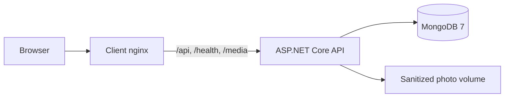
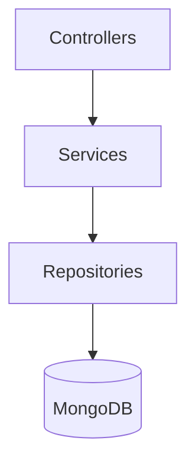

# Architecture

## System

The client is a static React application. Nginx serves it and reverse-proxies API, health, and media routes to the API container. The browser talks to one origin.

## Server layers

Controllers validate the HTTP boundary, call a service, and return a DTO. They do not contain business rules and they do not touch MongoDB. Entities never leave a controller.

Phase 0 has no business controllers. Health checks, exception handling, security headers, CORS, rate limiting, and index creation are wired so later phases add features without changing the host shape.

## Process model

- One ASP.NET Core process hosts controllers, middleware, and a hosted service that creates indexes at startup.
- `IMongoClient` is a singleton. `MongoContext` exposes collection accessors.
- Configuration is bound to options objects and validated on startup. Missing keys abort the process.
- Serilog writes structured logs to the console. Request bodies are not logged.

## Deployment

`docker-compose.yml` runs MongoDB 7, the API (non-root), and the client image. The API waits until MongoDB's healthcheck passes. Uploaded files will live on the `uploads_data` volume (the upload feature arrives in Phase 2).

GitHub Actions builds and tests the server (with Testcontainers MongoDB) and the client on pull requests and pushes to `main`.
